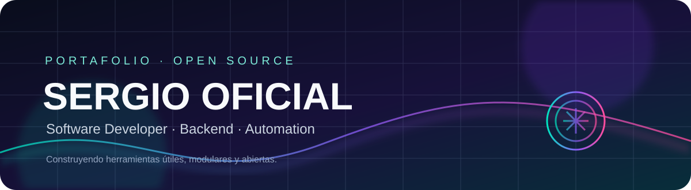
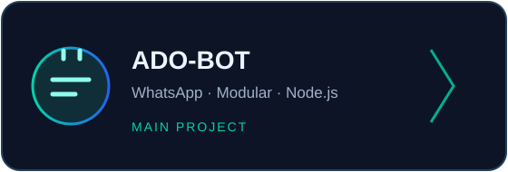
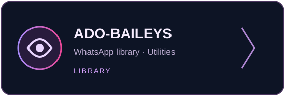

  <a href="#-sobre-mí">Sobre mí</a> ·
  <a href="#-proyectos">Proyectos</a> ·
  <a href="#-tecnologías">Tecnologías</a> ·
  <a href="#-estadísticas">Estadísticas</a> ·
  <a href="#-contacto">Contacto</a>

## ✦ Sobre mí

<table>
<tr>
<td width="62%" valign="top">

¡Hola! Soy **Sergio Gómez Gort**, desarrollador de software enfocado en crear herramientas, automatizaciones y proyectos de código abierto.

Me interesa especialmente el desarrollo backend con **JavaScript y Node.js**, la arquitectura modular y los bots para plataformas de mensajería. Disfruto transformar ideas en proyectos mantenibles, documentados y útiles para otras personas.

- ⚙️ **Construyendo:** [Ado-Bot](https://github.com/SergioOficial/ado-bot), un proyecto de bot para WhatsApp.
- 🧩 **Desarrollando:** [Ado-Baileys](https://github.com/SergioOficial/ado-baileys), librería relacionada con ese ecosistema.
- 🧠 **Explorando:** automatización, inteligencia artificial y diseño de sistemas.
- 🤝 **Colaboración:** abierto a contribuciones y proyectos Open Source.

</td>
<td width="38%" align="center" valign="middle">

 

Backend · Bots · Open Source

</td>
</tr>
</table>

## ✧ Proyectos

  
  

| Proyecto | Descripción |
|:--|:--|
| [Ado-Bot](https://github.com/SergioOficial/ado-bot) | Bot de WhatsApp con enfoque modular y extensible. Consulta el repositorio para conocer sus funciones y requisitos actuales. |
| [Ado-Baileys](https://github.com/SergioOficial/ado-baileys) | Paquete basado en Baileys que reúne la integración principal y utilidades adicionales. |

## ⌘ Tecnologías

## ◈ Estadísticas

## ☏ Contacto

¿Te interesa alguno de mis proyectos? Puedes explorar el código, abrir un issue o contribuir mediante un pull request.

  

«La automatización no es magia: es creatividad, lógica y código.»

 

Hecho con dedicación desde Cuba para la comunidad global 🌎

